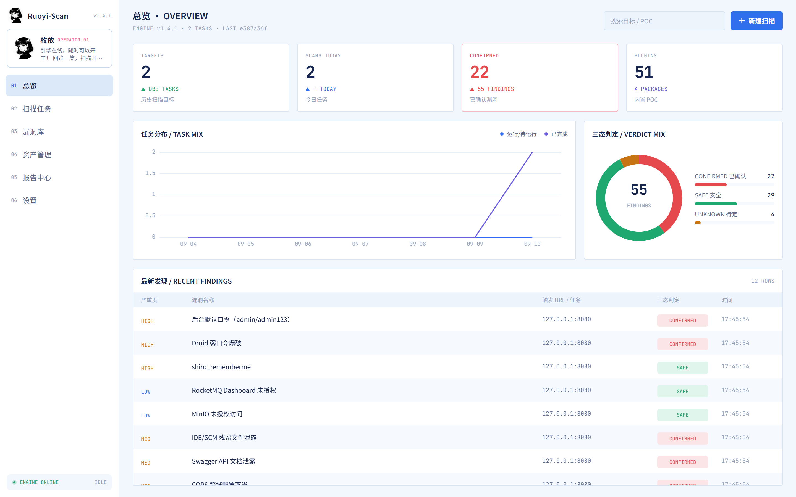

# Ruoyi-Scan — RuoYi Dedicated Vulnerability Scanner

[English](README_EN.md) | [中文](README.md)

[](https://github.com/xiabai2008/Ruoyi-Scan/actions/workflows/ci.yml)
[](https://pypi.org/project/ruoyi-scan/)
[](https://pypi.org/project/ruoyi-scan/)
[](LICENSE)
[](https://www.python.org/)
[](https://codecov.io/gh/xiabai2008/Ruoyi-Scan)
[](https://securityscorecards.dev/viewer/?uri=github.com/xiabai2008/ruoyi-scan)
[](https://star-history.com/#xiabai2008/ruoyi-scan&Date)

```bash
pip install ruoyi-scan
```

> A legally authorized **RuoYi-dedicated vulnerability scanner** with a plugin-based architecture and three-state verdict (CONFIRMED / SAFE / UNKNOWN).
> Supports enterprise-grade features such as batch scanning, multi-format reporting, WAF bypass (including an adversarial transport layer), exploit chains, and a Web API.

> **Why RuoYi?** RuoYi is one of the most widely used open-source Java admin frameworks in China — countless enterprise, outsourced, and even student projects are built on it, yet it had no dedicated scanner. This tool is purpose-built for its attack surface: version-aware POCs for the RuoYi family (Vue3 / App / Plus / Cloud-Plus / Magic) plus Spring Boot.
> If this tool helps you, please give it a ⭐ — it helps other security folks discover it.

---

## Desktop App · Single EXE, Double-click to Run

> The engine, 53 POCs, and the Web console are embedded into **one executable at build time**. No Python, no Docker, no environment setup.

<p align="center">
  
</p>

**Overview** — real-time three-state verdict distribution, scan trends, and latest findings. SAFE and UNKNOWN are displayed separately from CONFIRMED by design.

| Form | File | Notes |
|------|------|-------|
| Portable | [`ruoyi-scan-desktop.exe`](https://github.com/xiabai2008/ruoyi-scan/releases/latest/download/ruoyi-scan-desktop.exe) | ~46 MB, no installation required |
| Installer | [`Ruoyi-Scan_*_x64-setup.exe`](https://github.com/xiabai2008/ruoyi-scan/releases/latest) | NSIS installer, ~40 MB, includes uninstall cleanup |
| CLI | `pip install ruoyi-scan` | For CI / server environments |

Implementation notes:

- **Single-file distribution** — the PyInstaller engine is embedded into the Rust shell at compile time; it self-extracts to `%LOCALAPPDATA%\Ruoyi-Scan\engine\` and upgrades automatically by checksum/version stamp.
- **Process cleanup** — the engine child process is attached to a Windows JobObject (`KILL_ON_JOB_CLOSE`), so a hard-killed shell leaves no orphan processes.
- **Uninstall cleanup** — NSIS `installerHooks` removes the extracted engine cache after uninstall.

> See the [desktop documentation](docs/desktop.md) for details.

---

## Why Not a Generic Scanner

> Ruoyi-Scan **complements** nuclei / xray rather than competing with them — they cover breadth; we cover RuoYi-ecosystem depth and verdict discipline.

| Dimension | nuclei | xray | **Ruoyi-Scan** |
|-----------|--------|------|----------------|
| Positioning | General POC engine | General Web scanner | **RuoYi / Chinese Java framework specialist** |
| RuoYi variant identification | — | — | **5 variants** (Vue3 / App / Plus / Cloud-Plus / Magic) |
| Version-aware POC filtering | — | — | **4.2 / 4.7 / v5 / 3.9.x version matrix** |
| Handling unconfirmed findings | No such concept | No such concept | **Three-state verdict**: CONFIRMED / SAFE / UNKNOWN |
| Network anomalies | Error or skip | — | **Forced UNKNOWN — never masquerades as SAFE** |
| Compliance mapping | — | — | MLPS 2.0 / OWASP **report-level chapters** |
| Security service deliverables | — | Partial | 7 formats + **docx template engine + remediation retest** |
| nuclei templates | Native | Unsupported | **Compatible execution** (HTTP protocol subset + safety whitelist) |

**In one sentence**: a generic scanner tells you "there may be something here"; Ruoyi-Scan tells you "this vulnerability exists / does not exist / cannot be determined" — and produces a deliverable report.

---

## Project Overview

- **Author**: XIABAI
- **Version**: 1.5.0
- **Repository**: https://github.com/xiabai2008/Ruoyi-Scan
- **Tech Stack**: Python 3.8+ / requests / FastAPI / Docker
- **License**: MIT License

---

## Core Capabilities

| Module | Description |
|--------|-------------|
| `plugins/ruoyi/` | 20 RuoYi plugins (including 2 RuoYi-Plus-exclusive; file read, SQL injection, RCE, SSTI, unauthorized access, etc.) + 5 variant detection (Vue3/App/Plus/Cloud-Plus/Magic) |
| `plugins/spring/` | 14 Spring Boot POCs (Actuator, Gateway, Jolokia, Spring4Shell, etc.) |
| `plugins/common/` | Common vulnerability package, 11 plugins (.git/.env leakage, backup files, CORS, Swagger, middleware unauthorized access, etc.) |
| `plugins/jeecgboot/` | JeecgBoot extension plugin package (8 plugins, first non-RuoYi framework extension) |
| Fingerprinting | favicon hash + signature paths + keywords, multi-CMS data-driven + RuoYi variant subdivision |
| Component version detection | 20 Java components (fastjson/SpringBoot/Shiro/Nacos/Log4j/Tomcat/Jenkins/Grafana etc.) version → CVE mapping (`--components`) |
| Three-state verdict | CONFIRMED (confirmed present) / SAFE (confirmed absent) / UNKNOWN (cannot be determined) |
| WAF bypass | 11 bypass strategies + adversarial transport (Scrapling) fallback + three-state verdict protection matrix + success-rate tracking |
| Adversarial transport | `--adversarial-transport` — Scrapling fingerprint spoofing / stealth browser to bypass Cloudflare and JS challenges (`[adversarial]` optional extra, see below) |
| Exploit chains | DAG topological orchestration + conditional branches + 3 built-in chains |
| nuclei template compatible | Run nuclei-templates YAML directly (`--nuclei`, HTTP protocol subset + safety whitelist) |
| Plugin template repo | Export/manifest/Ed25519 signing/`--plugin-update` community distribution |
| AI POC generation | `--ai` natural-language plugin generation (LLM self-verify loop, rule fallback without key) + `--ai-validate` validate-on-generate / `--ai-triage` UNKNOWN noise reduction |
| AI report analysis | `--ai-report zh\|en` auto vulnerability analysis & fix priority |
| Batch scanning | `-f targets.txt` multi-target + aggregated summary report |
| Report output | HTML (SVG charts) / JSON / CSV / PDF / Word / Excel / SARIF + version matrix + docx template engine + remediation retest (`--remediation`) |
| Web API | FastAPI REST + WebSocket real-time push + Web console + role-based keys (read/scan/admin) + scheduled scans |
| Concurrency & rate limiting | ThreadPoolExecutor + token bucket (sleep outside lock, no concurrency degradation) |
| CAPTCHA handling | Auto-detect / OCR recognition / skip — three modes |
| Multi-version adaptation | RuoYi 4.2 / 4.7 / v5 / v3.9.x version-aware POC filtering |
| Port scanning | TCP port scan + service identification + banner grabbing |
| Passive proxy | HTTP/HTTPS proxy, captures traffic for automatic scanning |
| OAST out-of-band detection | Self-hosted callback server + 6 payload templates (SSRF/XXE/blind SQLi/blind RCE/LDAP/command injection) |
| Business logic detection | IDOR / privilege escalation / parameter tampering / race condition — 4 detector types |
| Authenticated deep scan | `--auth-surface` login-state API surface inventory + authorization matrix (anonymous replay / low-privilege replay) |
| CVE sync | NVD + GHSA dual-source fallback + 24h TTL cache + CWE→OWASP/MLPS compliance mapping |
| SIEM integration | ECS / CEF / LEEF / JSON — 4 export formats + Syslog forwarding |
| Async engine | ThreadPoolExecutor concurrent scanning + aiohttp optional async HTTP |
| Distributed scanning | Redis Master-Worker queue + Standalone fallback mode |
| Result caching | SQLite persistence + SHA256 key + TTL + hit-rate statistics |
| Scan templates | quick / deep / compliance / dengbao — 4 preset strategies |
| Authenticated scanning | Cookie / Token / Bearer / auto-login — 4 auth injection types |
| Internationalization | Chinese/English report switching (`--lang zh|en`) |
| Plugin SDK | Template generation + validation + enumeration (`--plugin-init` / `--plugin-check`) |
| CI/CD integration | Severity-threshold exit + GitHub Code Scanning (SARIF) + GitLab/Jenkins templates |
| Vulnerability knowledge base | Offline HTML Wiki + JSON API |

---

## Quick Start

### Option 1: Install via pip (Recommended)

```bash
# Install (auto-installs core dependencies)
pip install ruoyi-scan

# Optional feature dependencies (install on demand)
pip install pyyaml          # --config YAML configuration file
pip install redis           # --distributed Redis distributed scanning
pip install aiohttp         # --async async HTTP client
pip install "ruoyi-scan[adversarial]"  # --adversarial-transport Scrapling adversarial transport

# Run a scan
ruoyi-scan -p http://target:8080/
```

### Option 2: Install from Release (Offline environments)

Go to the [Releases page](https://github.com/xiabai2008/Ruoyi-Scan/releases), download the latest `.whl` file, then:

```bash
pip install ruoyi_scan-1.5.0-py3-none-any.whl
```

### Option 3: Install from Source

```bash
git clone https://github.com/xiabai2008/Ruoyi-Scan.git
cd Ruoyi-Scan
pip install -r requirements.txt

# Single-target vulnerability scan
python main.py -p http://target:8080/

# Batch scanning
python main.py -f targets.txt -p --report ./reports

# Manually specify CMS (skip fingerprinting)
python main.py -p http://target:8080/ --cms ruoyi

# Comprehensive scan (directory scan + vulnerability detection + login brute force)
python main.py -u http://target:8080/

# Generate all-format reports (HTML/JSON/CSV/PDF/Word/Excel)
python main.py -p http://target:8080/ --report ./reports --report-format all

# docx compliance report template / remediation retest (G5)
python main.py -p http://target:8080/ --report ./reports --report-template ./templates/compliance.docx
python main.py -p http://target:8080/ --remediation ./baseline.json --report ./reports

# WAF bypass (auto-enabled when a WAF is detected)
python main.py -p http://target:8080/ --bypass-waf auto

# Adversarial transport (Scrapling; requires the [adversarial] optional extra)
python main.py -p http://target:8080/ --adversarial-transport

# Execute exploit chain
python main.py --chain ruoyi_sql_to_rce -u http://target:8080/
python main.py --chain list  # List available chains

# Web API service
python main.py --serve
# Visit http://localhost:8000/ (Web console)
# Visit http://localhost:8000/docs (OpenAPI docs)

# Port scan + vulnerability detection
python main.py -p http://target:8080/ --portscan

# Passive proxy mode
python main.py --passive --passive-port 8080

# Docker deployment (see the "Docker Deployment" section below)
# docker-compose up -d
```

### Docker Deployment

Ruoyi-Scan provides a production-ready Docker image (multi-stage build, non-root user).

**Build the image**

```bash
docker build -t ruoyi-scan .
```

**Scan a target**

```bash
# Basic scan
docker run --rm ruoyi-scan -p http://target/

# Scan and save the report to the host
docker run --rm -v $(pwd)/reports:/app/reports ruoyi-scan \
  -p http://target/ --report /app/reports
```

**Web API service**

```bash
# Start the FastAPI Web API (port 8000)
docker run --rm -p 8000:8000 ruoyi-scan --serve --host 0.0.0.0 --port 8000

# API with authentication
docker run --rm -p 8000:8000 -e RUOYI_SCAN_API_KEY=your-secret ruoyi-scan \
  --serve --host 0.0.0.0 --port 8000 --api-key your-secret
```

**Docker Compose one-click deployment**

```bash
# Start all services (scanner + API + 2 signed labs)
docker compose up -d

# Scan the built-in lab
docker compose run --rm scanner -p http://lab-ruoyi:8080/ --report /app/reports

# Start the monitoring stack (Prometheus + Grafana)
docker compose --profile monitor up -d
# Grafana: http://localhost:3000 (admin/admin)
# Prometheus: http://localhost:9090

# Clean up
docker compose down
```

| Service | Port | Description |
|---------|------|-------------|
| scanner | - | Scanner CLI (invoked via `docker compose run`) |
| api | 8000 | FastAPI Web API + WebSocket + Web console |
| lab-ruoyi | 8080 | RuoYi signed lab (vuln mode) |
| lab-spring | 8091 | Spring Boot signed lab (vuln mode) |
| prometheus | 9090 | Metrics collection (`--profile monitor`) |
| grafana | 3000 | Monitoring dashboard (`--profile monitor`) |

### CLI Parameter Reference

> For full parameter details, run `python main.py -h`. All parameters are grouped by function below.

#### Core Scan Modes

| Parameter | Description |
|-----------|-------------|
| `-h` | Help information |
| `-u <url>` | Comprehensive scan (directory + vulnerability + brute force) |
| `-m <url>` | Directory scan |
| `-p <url>` | Vulnerability detection |
| `-l <url>` | Login brute force |
| `-f <file>` | Batch scan (read target list from file) |
| `--cms <ruoyi\|spring>` | Manually specify CMS (skip fingerprinting) |
| `--pass-level <lvl>` | Password dictionary level top100/top1000/full |
| `--template <name>` | Scan template (quick/deep/compliance/dengbao) |
| `--template-list` | List all available templates |
| `--config <path>` | YAML configuration file (CLI parameters take precedence over config) |

#### Network & Concurrency

| Parameter | Description |
|-----------|-------------|
| `--proxy <url>` | Proxy address (e.g. http://127.0.0.1:8080) |
| `--proxy-file <f>` | Proxy pool file (one proxy URL per line) |
| `--proxy-rotate <s>` | Proxy rotation strategy round-robin/random/least-fail |
| `--threads <n>` | Number of concurrent threads |
| `--rate <n>` | Requests per second (0 = no rate limit) |
| `--timeout <n>` | Request timeout in seconds |
| `--debug` | Debug mode (request logs output to stderr) |
| `--skip-preflight` | Skip target reachability preflight (e.g. through proxies) |
| `--verify-tls` | Verify target TLS certificates (off by default for internal self-signed certs) |

#### Information Gathering (D14)

| Parameter | Description |
|-----------|-------------|
| `--crawl` | Enable active crawler |
| `--crawl-depth <n>` | Maximum crawler depth (default 2) |
| `--crawl-max-pages <n>` | Maximum crawler pages (default 50) |
| `--subdomain` | Enable subdomain enumeration |
| `--js-extract` | Enable JS endpoint extraction |
| `--portscan` | Port scan + service identification |
| `--ports <p1,p2>` | Custom port list (comma-separated) |
| `--passive` | Start passive proxy mode |
| `--passive-host <addr>` | Proxy listen address (default 127.0.0.1) |
| `--passive-port <n>` | Proxy listen port (default 8080) |

#### Reporting & Output

| Parameter | Description |
|-----------|-------------|
| `--report <dir>` | Report output directory |
| `--report-format <f>` | Report format html/json/csv/pdf/docx/xlsx/sarif |
| `--no-dedup` | Disable result deduplication/aggregation |
| `--lang <zh\|en>` | Report language (default zh) |
| `--diff <old.json>` | Compare against a historical scan report |
| `--diff-only <old> <new>` | Only compare two JSON reports |
| `--save-baseline` | Save this scan result as a baseline |
| `--report-template <path>` | docx compliance report template (placeholder injection, G5) |
| `--remediation <baseline.json>` | Remediation retest: compare against a baseline and produce a verification report (G5) |
| `--no-cta` | Disable the repository call-to-action at the end of a scan |

#### WAF Bypass & Exploit Chains

| Parameter | Description |
|-----------|-------------|
| `--bypass-waf <auto\|on\|off>` | WAF bypass strategy (default auto) |
| `--adversarial-transport` | Enable the adversarial transport layer (Scrapling fingerprint spoofing / stealth browser for CF/JS challenges; requires the `[adversarial]` extra) |
| `--chain <name>` | Execute an exploit chain |
| `--chain-list` | List all available exploit chains |

#### Component Detection & nuclei Templates (D4/E2)

| Parameter | Description |
|-----------|-------------|
| `--components` | Component version detection (20 Java components → CVE mapping) |
| `--no-components` | Disable component version detection |
| `--nuclei <dir\|file>` | Load nuclei YAML templates (repeatable) |
| `--nuclei-tags <a,b>` | Only load templates containing the given tags |
| `--nuclei-severity <s>` | Only load templates with the given severity (high/medium/low) |
| `--nuclei-exclude-tags <a,b>` | Exclude templates containing the given tags |
| `--nuclei-validate <path>` | Validate nuclei templates without scanning |

#### Authenticated Scanning (D26)

| Parameter | Description |
|-----------|-------------|
| `--auth <type=value>` | Authentication injection (can be specified multiple times) |
| `--auth-file <path>` | Load authentication info from file |
| `--auth-login <user:pass>` | Auto-login to obtain authentication |

#### Web API Service (D9/D11)

| Parameter | Description |
|-----------|-------------|
| `--serve` | Start Web API service (FastAPI + WebSocket + Web console) |
| `--host <addr>` | API service listen address (default 0.0.0.0) |
| `--port <n>` | API service listen port (default 8000) |
| `--api-key <key>` | API Key authentication |
| `--cors-origins <o>` | Allowed CORS origins (comma-separated) |
| `--db-path <path>` | SQLite task persistence database path |
| `--schedule <cron>` | Scheduled scan expression (5-field cron or `every:<seconds>`) |
| `--schedule-target <url>` | Scheduled scan target URL |

> For detailed API endpoint descriptions, request/response examples, and WebSocket event formats, see the [API Usage Guide](docs/api.md).
> The OpenAPI 3.0 specification can be exported to `docs/openapi.json` via `python scripts/export_openapi.py`.

#### OAST Out-of-Band Detection (D30)

| Parameter | Description |
|-----------|-------------|
| `--oast` | Enable OAST out-of-band detection |
| `--oast-server` | Start the OAST callback server |
| `--oast-host <addr>` | OAST server listen address |
| `--oast-port <n>` | OAST server listen port |

#### Business Logic Detection (D31)

| Parameter | Description |
|-----------|-------------|
| `--logic-scan` | Business logic vulnerability detection (IDOR/privilege escalation/parameter tampering/race condition) |
| `--logic-endpoints <file>` | Business scan endpoint list file |
| `--logic-concurrency <n>` | Concurrency for race condition detection |

#### Authenticated Deep Scan (G1)

| Parameter | Description |
|-----------|-------------|
| `--auth-surface` | Login-state API surface inventory + authorization matrix (requires `--auth-login user:pass`) |
| `--surface-account <user:pass>` | Low-privilege account (vertical privilege comparison, repeatable) |
| `--surface-output <path>` | Surface asset inventory JSON output path |

#### AI Capabilities (E7/E8/G3)

| Parameter | Description |
|-----------|-------------|
| `--ai <desc>` | AI plugin generation (LLM first, rule-template fallback without a key) |
| `--ai-validate [path]` | Validate-on-generate (signed-lab three-state; no argument = validate after generation) |
| `--ai-triage` | UNKNOWN noise reduction (cluster routing, optional LLM) |
| `--ai-name <name>` | AI plugin name (defaults to the description) |
| `--ai-api-key <key>` | LLM API key (environment variable `RUOYI_AI_API_KEY`) |
| `--ai-model <model>` | LLM model name (default gpt-4o-mini) |
| `--ai-retries <n>` | Maximum AI self-validation retry rounds |
| `--ai-report [zh\|en]` | Generate an AI vulnerability analysis summary after the report (template fallback without a key) |

#### CVE Sync (D32)

| Parameter | Description |
|-----------|-------------|
| `--cve-sync` | Sync CVE information from NVD / GHSA |
| `--cve-id <CVE-ID>` | Query a single CVE |
| `--cve-offline <component>` | Query the offline CVE database by component (intranet mode) |
| `--nvd-api-key <key>` | NVD API Key (improves rate limit) |

#### SIEM Integration (D33)

| Parameter | Description |
|-----------|-------------|
| `--siem-export <fmt>` | Export SIEM format (ecs/cef/leef/json) |
| `--siem-output <path>` | SIEM export path |
| `--siem-syslog <host:port>` | Send to a Syslog server |
| `--siem-protocol <p>` | Syslog protocol udp/tcp |

#### Async Engine (D34)

| Parameter | Description |
|-----------|-------------|
| `--async` | Enable async scan engine (ThreadPoolExecutor) |
| `--async-workers <n>` | Number of async concurrent threads (default 10) |

#### Web UI Console (D35)

| Parameter | Description |
|-----------|-------------|
| `--web-ui` | Generate a Web UI console (single-page HTML) |
| `--web-ui-output <path>` | Web UI output path |
| `--web-ui-api <url>` | API address the Web UI connects to |

#### Distributed Scanning (D36)

| Parameter | Description |
|-----------|-------------|
| `--distributed <mode>` | Distributed mode (master/worker/standalone) |
| `--redis-url <url>` | Redis connection URL |
| `--distributed-rate <n>` | Global distributed rate limit (requests per second, 0 = unlimited) |
| `--worker-max-tasks <n>` | Worker max tasks (0 = unlimited) |
| `--distributed-timeout <n>` | Distributed timeout in seconds (default 600) |

#### Result Caching (D37)

| Parameter | Description |
|-----------|-------------|
| `--cache` | Enable scan result caching (SQLite) |
| `--cache-ttl <n>` | Cache TTL in seconds (default 3600) |
| `--cache-db <path>` | Cache database path |
| `--cache-stats` | View cache statistics |
| `--cache-clear` | Clear expired cache |
| `--cache-clear-all` | Clear all cache |

#### Notifications (D21)

| Parameter | Description |
|-----------|-------------|
| `--notify <type=target>` | Scan completion notification (can be specified multiple times) |

#### Plugin SDK (D25)

| Parameter | Description |
|-----------|-------------|
| `--plugin-init <name>` | Generate a plugin template |
| `--plugin-new <name>` | Create a new plugin scaffold |
| `--plugin-path <dir>` | Load a third-party plugin directory |
| `--plugin-check <path>` | Validate plugin file integrity |
| `--plugin-list` | List all loaded plugins |
| `--category <cat>` | Plugin category ruoyi/spring/common |

#### Plugin Template Repository (E5)

| Parameter | Description |
|-----------|-------------|
| `--plugin-export <dir>` | Export plugin sources and metadata to a directory (template repository) |
| `--plugin-manifest <dir>` | Generate/verify manifest.json (Ed25519 signature) |
| `--plugin-update [url]` | Update plugins from the template repository (mandatory Ed25519 verification; requires cryptography + a trusted public key) |

#### CI/CD Integration (D28)

| Parameter | Description |
|-----------|-------------|
| `--ci` | CI mode (non-zero exit code when severity exceeds threshold) |
| `--severity-threshold <lvl>` | CI failure threshold low/medium/high (default high) |
| `--ci-init <platform>` | Generate CI config (github/gitlab/jenkins) |

#### Vulnerability Knowledge Base (D29)

| Parameter | Description |
|-----------|-------------|
| `--wiki` | Generate vulnerability knowledge base (HTML Wiki + JSON API) |
| `--wiki-output <path>` | Knowledge base output path |

---

## Directory Structure

```
Ruoyi-Scan/
├── main.py                  # CLI entry point (542 lines, pure arg parsing + dispatch)
├── config/settings.py       # Global configuration
├── cli/                     # CLI control layer
│   ├── dispatcher.py        # Mode dispatch (tool / service / scan)
│   ├── runner.py            # Scan mode executor (args → ScanRequest)
│   └── ...                  # preflight / serve_runner / chain_runner, etc.
├── core/                    # Core engine layer
│   ├── orchestrator.py      # Scan orchestrator (shared by CLI and Web API)
│   ├── engine.py            # Concurrency orchestration + token-bucket rate limiting
│   ├── models.py            # Data models (three-state verdict)
│   ├── loader.py            # Dynamic plugin discovery
│   ├── fingerprint.py       # Fingerprinting
│   ├── router.py            # Fingerprint → plugin routing
│   ├── session.py           # Session wrapper
│   ├── chain.py             # Exploit chain engine
│   ├── report.py            # Report rendering (HTML/JSON/CSV)
│   └── ...                  # More core modules
├── plugins/                 # Plugin system
│   ├── base.py              # PluginBase abstract base class
│   ├── ruoyi/               # 20 RuoYi plugins (2 Plus-exclusive)
│   ├── spring/              # 14 Spring POCs
│   ├── jeecgboot/           # 8 JeecgBoot plugins
│   ├── common/              # 11 common plugins
│   └── chain/               # 3 exploit chains
├── lib/                     # Utility library (42 modules)
├── api/                     # Web API (FastAPI + WebSocket)
├── data/                    # Dictionary files
├── tests/                   # 67 test files / 1300+ test cases
├── lab/                     # Lab environments
├── web/                     # Web console frontend
├── monitoring/              # Grafana + Prometheus
├── desktop/                 # Tauri desktop app (React frontend + Rust shell + embedded engine)
├── scripts/                 # Build / acceptance / OpenAPI export scripts
├── .github/workflows/       # CI configuration
├── Dockerfile               # Docker image
├── docker-compose.yml       # Docker Compose
├── LICENSE                  # MIT License
└── requirements.txt         # Dependency management
```

---

## Documentation

> 📖 **[Online documentation](https://xiabai2008.github.io/ruoyi-scan/)** — all docs are organized and published with mkdocs-material.

| Document | Description |
|----------|-------------|
| [Quick Start](docs/quickstart.md) | From installation to your first report in 5 minutes |
| [User Guide](docs/usage.md) | Installation, scan modes, CLI reference |
| [Plugin Development](docs/plugin_dev.md) | PluginBase, three-state verdicts, entry_points registration |
| [API Reference](docs/api.md) | REST endpoints, WebSocket events, OpenAPI spec |
| [Desktop App](docs/desktop.md) | Single portable EXE with an embedded engine |
| [Contributing](CONTRIBUTING.md) | Development workflow, coding standards, commit conventions |
| [Changelog](CHANGELOG.md) | Version history and changes |
| [Roadmap](ROADMAP.md) | G-series plans, community roadmap, metrics |

---

## Testing

```bash
# Full test suite
python -m pytest tests/ -q

# RuoYi plugin regression
python tests/regression_ruoyi.py

# Spring plugin regression
python tests/regression_spring.py
```

---

## Contributing

Contributions of POCs and improvements are welcome:

- **Report a bug / request a POC**: use the [issue templates](https://github.com/xiabai2008/Ruoyi-Scan/issues/new/choose) (bug / POC request / feature request)
- **Submit a POC**: `python main.py --plugin-init <name>` → implement `verify()` (three-state verdict) → `--plugin-check` → PR (the template includes a full checklist)
- **Plugin distribution**: merged plugins are published to the official [ruoyi-scan-templates](https://github.com/xiabai2008/ruoyi-scan-templates) repository (Ed25519 signed)
- **Development guides**: [docs/plugin_dev.md](docs/plugin_dev.md) / [CONTRIBUTING.md](CONTRIBUTING.md)

> Before contributing a POC, reproduce it on the built-in lab (`lab/`) or an authorized target so the detection signature is reliable.

---

## Security & Compliance

This tool is intended solely for **authorized** security testing and research. It must not be used against unauthorized targets. Exploitation-related plugins perform existence verification only and do not cause actual damage by default.

The adversarial transport layer (Scrapling) is an **optional extra** (`[adversarial]`) and is not installed by default; when enabled it remains restricted to authorized testing.

**Supply-chain verification**: Release artifacts include SHA256 checksums for independent verification; starting with v1.4.3 they also include SLSA build provenance.

> v1.4.2 and earlier have **no** provenance — the attestation step was merged into `release.yml` 48 minutes after v1.4.2 was released. For those versions, use checksums only; `gh attestation verify` will return not found.

```bash
# Checksum verification (all versions)
sha256sum -c checksums.txt
# SLSA build provenance verification (requires the gh CLI; v1.4.3+ artifacts)
gh attestation verify ruoyi_scan-<version>-py3-none-any.whl -R xiabai2008/ruoyi-scan
```

---

## License

MIT License © 2026 XIABAI
